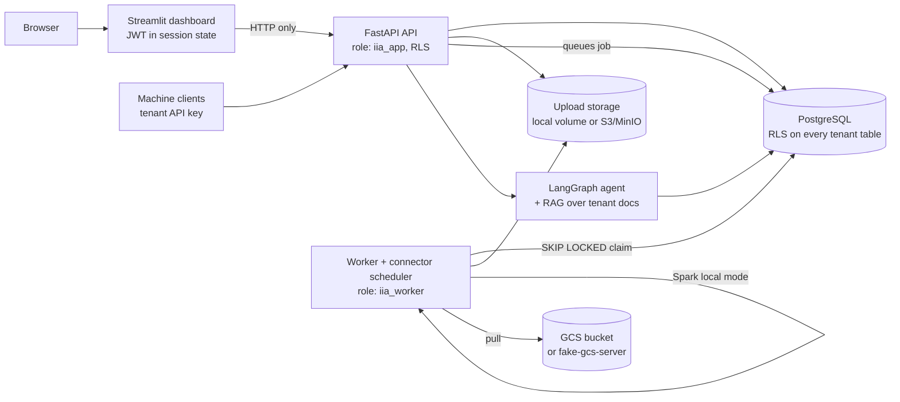
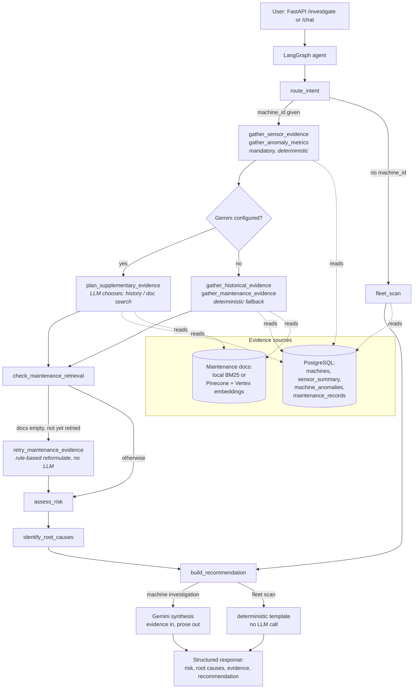

# Industrial Intelligence Agent

An AI operations decision-support system that investigates abnormal machine
behavior and returns evidence-backed maintenance recommendations — not a
chatbot that talks about factories, a system that queries sensor history,
maintenance records, and equipment documentation first, and only then lets
an LLM explain what the evidence says.

Built as a portfolio project demonstrating the skills for a Fresher
Python/AI Engineer role: PySpark data processing, PostgreSQL,
retrieval-augmented generation over a maintenance knowledge base, a
LangGraph agent with real tool use, Google Vertex AI / Gemini, and a
FastAPI + Streamlit application, containerized with Docker.

## Table of contents

- [Problem & business framing](#problem--business-framing)
- [Architecture](#architecture)
- [What's real vs stubbed](#whats-real-vs-stubbed)
- [Demo walkthrough](#demo-walkthrough)
- [Dashboard](#dashboard)
- [Design decisions](#design-decisions)
- [Data](#data)
- [Technology choices](#technology-choices)
- [Agent workflow](#agent-workflow)
- [PySpark pipeline](#pyspark-pipeline)
- [RAG pipeline](#rag-pipeline)
- [API](#api)
- [Multi-tenancy](#multi-tenancy)
- [Onboarding a tenant's own data](#onboarding-a-tenants-own-data)
- [Uploads and the background worker](#uploads-and-the-background-worker)
- [Users, roles and login](#users-roles-and-login)
- [Scheduled pull connector (GCS)](#scheduled-pull-connector-gcs)
- [Setup](#setup)
- [Example investigation](#example-investigation)
- [Testing](#testing)
- [Screenshots](#screenshots)
- [Limitations](#limitations)
- [Future improvements](#future-improvements)

## Problem & business framing

Factory operations teams see a flood of sensor telemetry and can't
manually correlate it with maintenance history and equipment documentation
fast enough to catch degradation before it becomes downtime. This system
answers operational questions —"why is M-17 underperforming?", "which
machines need inspection first?", "what changed?" — by gathering evidence
from four sources (sensor trend data, historical machine data, maintenance
records, and maintenance documentation) and only then having an LLM
synthesize what the evidence supports. The LLM never invents a statistic,
a risk level, or a machine ranking; those are computed deterministically
in Python/SQL before the LLM ever sees the question.

This is a portfolio demonstration against public and synthetic data —
**not** a system deployed at a real factory, and any business-impact
figures below are estimates, not measured outcomes.

## Architecture

### System



The dashboard never opens a database connection and never names a tenant: it signs in with
`POST /auth/login`, keeps the JWT in the browser session, and calls the API, where the token decides the
tenant and role and Postgres row-level security enforces the tenant. The API process (`iia_app`) and the
worker process (`iia_worker`) are separate containers with separate least-privilege database roles. There is
no separate scheduler container: the worker's poll loop also ticks the connector scheduler.

### Agent



Before any of this runs, the API layer resolves *which* machine (if any)
the request is actually about: the question text is parsed for machine
references (`app/agents/query_parser.py`) and reconciled with the optional
`machine_id` field — an unrecognized machine in the text is a 404, a
question naming several machines or a `machine_id` that disagrees with
the text is a 422, and a question naming none falls back to `machine_id`
or, absent that, a fleet scan. This is deliberately regex/set-membership,
not an LLM call — which machine a question names is a fact about the
text, not a judgement call. See `resolve_target` in `app/api/routes.py`.

A machine-specific question always gathers sensor and anomaly evidence
deterministically first — that pair can never be skipped, by either
branch below it, because risk assessment depends on it directly. What
varies is only the two *supplementary* evidence types (maintenance
history, documentation search): when Gemini/Vertex is configured, a real
LLM decides whether/how to gather them (`app/agents/planner.py`); when
it isn't, a deterministic fallback gathers both unconditionally. Either
way, a rule-based (no LLM) retry step reformulates and retries once if
the documentation search came back empty, before risk-assessment →
root-cause → Gemini-synthesis runs — identically regardless of which
branch gathered the evidence. A fleet-wide question ("which machines are
abnormal?") runs every machine through the *same* deterministic risk
rule and returns a ranked report without an LLM call at all — there's
nothing for a model to synthesize when the answer is already a sorted
list of numbers.

## Data

| Source | What it is | Used for |
|---|---|---|
| **UCI AI4I 2020 Predictive Maintenance** | Real public dataset | Machine failure/failure-type reference data (`ai4i_reference` table) |
| **Synthetic operational data** | Generated (`scripts/generate_synthetic_data.py`, seed=42) | 5-minute sensor readings for an 18-machine fleet, with 6 deliberately injected failure scenarios (TWF, HDF, PWF, OSF, RNF, TWF_RECURRING) so risk logic has known ground truth to test against |
| **Synthetic maintenance log** | Generated | Maintenance event history per machine |
| **Maintenance documentation** (`documents/`) | Written for this project | 7 markdown docs — SOPs, an equipment manual, a safety procedure, a troubleshooting guide, historical incident reports — chunked and embedded for RAG |

No real factory, real customer, or real sensor installation is represented
anywhere in this project. Where the fleet composition or scenario config
is need to be understood, see `spark_jobs/config.py` — every "magic
number" in the generator lives there, not scattered through code.

## Technology choices

| Choice | Why |
|---|---|
| **PySpark**, local mode, over Pandas | Demonstrates DataFrame transformations, window functions, and rolling aggregations at the scale/spirit of a distributed pipeline, even though this MVP's data volume doesn't strictly require a cluster |
| **PostgreSQL** for structured data | Relational integrity for machines/readings/anomalies/maintenance, and a place to demonstrate indexed, windowed SQL queries (see `get_fleet_sensor_trend`'s `ROW_NUMBER() OVER (PARTITION BY ...)`) |
| **BM25 (local) + Pinecone (cloud)** retrieval, switchable via `RAG_BACKEND` | The local path needs no credentials and is what the test suite runs against; the cloud path demonstrates real vector search when credentials are available |
| **LangGraph** over a hand-rolled state machine | Explicit state, explicit nodes, explicit conditional routing — the graph in `app/agents/graph.py` is the actual agent, not a wrapper around free-form LLM planning |
| **Gemini via Vertex AI**, Application Default Credentials | No API key in the codebase; auth is `gcloud auth application-default login` or a mounted service-account key |
| **FastAPI + Streamlit**, not React | Function and architecture over frontend polish for a 2-day MVP scope |

## Agent workflow

Nodes (`app/agents/graph.py`, `app/agents/nodes.py`):

1. **`route_intent`** — machine_id present → `machine_investigation`; absent → `fleet_scan`.
2. **`gather_sensor_evidence` / `gather_anomaly_metrics`** — mandatory and deterministic for every machine investigation, unconditionally. Risk assessment depends on these directly, so they are not a choice either evidence-gathering path below can make — see "Evidence-gathering: deterministic vs. LLM-planned" below.
3. **`gather_historical_evidence` / `gather_maintenance_evidence`** (deterministic fallback) **or `plan_supplementary_evidence`** (LLM-planned, when Gemini is configured) — the two *supplementary* evidence types only; each tool call is independently error-handled (a failed tool degrades the investigation, it doesn't crash it).
4. **`check_maintenance_retrieval` → `retry_maintenance_evidence`** — a rule-based (no LLM) retry: if the documentation search came back empty, reformulate the query (drop the machine-ID token, add an inferred failure-mode filter) and retry exactly once, regardless of which path in step 3 gathered evidence.
5. **`assess_risk`** — deterministic. Risk is based on the *sustained* anomalous-reading rate over the last 24 hourly windows (≥25% → HIGH, ≥5% → MEDIUM), not a single noisy hour. A lone WATCH snapshot is not enough on its own.
6. **`identify_root_causes`** — separates observed facts from correlations from possible causes; never lets the LLM claim proven causation.
7. **`build_recommendation`** — for a machine investigation, hands the assembled evidence to Gemini for synthesis (structured-output validated); for a fleet scan, builds the ranked report from `risk_level` directly, no LLM call.

Every node's execution is logged (which node, which machine, how long,
success or failure) — see `app/core/logging_config.py` and the tracing
wrapper in `graph.py`.

### Evidence-gathering: deterministic vs. LLM-planned

Sensor and anomaly evidence — the two inputs `assess_risk` depends on —
are gathered the same way every time, with no LLM anywhere near that
decision: there is no tool name, prompt, or planner state that could
cause them to be skipped. What genuinely varies is only whether the two
*supplementary* evidence types (maintenance history, documentation
search) are gathered by a fixed two-call sequence or by a real Gemini
tool-calling loop (`app/agents/planner.py`) that decides whether either
would help, given a summary of the evidence already gathered.

Which one runs is feature-detected, not a flag you have to remember to
flip: whenever `GOOGLE_CLOUD_PROJECT` is configured, the LLM-planned path
runs automatically (`AGENTIC_ROUTING_ENABLED` defaults to `true`);
`AGENTIC_ROUTING_ENABLED=false` is available as an explicit kill-switch
for a reproducible, fully-deterministic run without unsetting
credentials. Report *synthesis* (the final Gemini prose step, below) is
the opposite shape on purpose — it stays off by default even with
credentials present, and needs `GEMINI_SYNTHESIS_ENABLED=true` explicitly,
because swapping the recommendation's output source is a bigger
behavioural change than the planner choosing which evidence to fetch. Tested offline against a scripted fake Gemini 3 client
(`tests/test_planner.py`) — including a direct replay of a lazy/broken
planner that calls no tools at all, asserting the investigation still
comes back with the correct risk level, because the planner was never
given a tool that could affect it.

## PySpark pipeline

`spark_jobs/` (run via `scripts/run_pipeline.py`):

`ingestion.py` (load + validate) → `feature_engineering.py` (derived
features, AI4I failure flags, rolling features) →
`anomaly_detection.py` (z-score flags, risk score, `sensor_summary` /
`machine_anomalies` aggregation) → Parquet under `data/processed/` →
loaded into Postgres by `scripts/load_postgres.py`.

## RAG pipeline

`documents/*.md` → `app/rag/chunking.py` (chunk, ~900 chars with 150
overlap) → `data/processed/document_chunks.jsonl` (committed — see
`Dockerfile`'s comment on why) → embedded and indexed:

- `RAG_BACKEND=local`: BM25 lexical search over the JSONL, no network calls.
- `RAG_BACKEND=pinecone`: Vertex AI `gemini-embedding-001` embeddings, Pinecone similarity search.
- `RAG_BACKEND=auto`: picks `pinecone` only when both `PINECONE_API_KEY` and `GOOGLE_CLOUD_PROJECT` are set, else `local`.

## API

| Endpoint | Purpose |
|---|---|
| `GET /machines` | List the fleet |
| `GET /machines/rank-for-inspection` | Deterministic "inspect first" ranking by raw anomaly volume/severity since a given timestamp — a narrower, cheaper question than a fleet scan; doesn't run the LangGraph agent at all (registered ahead of `/machines/{machine_id}` so the literal path matches first) |
| `GET /machines/{machine_id}` | One machine's metadata |
| `GET /machines/{machine_id}/health` | Latest health window (defect rate, tool wear, anomaly counts, sustained-rate `risk_level`, computed by the same `assess_risk` a machine investigation uses) |
| `GET /machines/{machine_id}/anomalies` | Recent anomaly events |
| `GET /machines/{machine_id}/sensors` | Hourly sensor-history trend — backs the Streamlit trend chart |
| `GET /sensors` | This tenant's sensor registry (name, unit, normal range, z-score threshold, enabled) |
| `GET /machines/{machine_id}/readings` | Raw long-format readings for one machine (`sensor`, `start`, `end`, `limit` filters); 404 for another tenant's machine |
| `GET /fleet/summary` | One page of machines (`limit` <= 200, `offset`) with latest window and the sustained-rate `risk_level` (same `assess_risk` rule as the agent's fleet scan) |
| `GET /machines/{machine_id}/series` | One sensor's readings bucketed in SQL (avg/min/max) with the sensor's unit and normal range; default last 7 days ending at the newest reading, `days` <= 31, window capped at 31 days, <= 1000 points |
| `GET /investigations`, `GET /investigations/{id}` | Stored `/investigate` and `/chat` results for the tenant (list = summaries, paginated; detail = full result) |
| `GET /units` | The unit catalog a mapping may use |
| `POST /sensors/{sensor_name}` | Admin: edit one sensor's normal range, z-score threshold, enabled flag (applies to later detection runs only) |
| `GET /healthz`, `GET /readyz` | Liveness (always 200) and readiness (`SELECT 1` against Postgres, else 503). No API key needed |
| `POST /investigate` | Full agent investigation. The target machine (if any) is resolved from both the question text and the optional `machine_id` field — see "Agent workflow" above; an unknown machine named in the question is a 404, an ambiguous request is a 422 |
| `POST /chat` | Same agent as `/investigate`, chat-shaped request/response (`message`/`reply`). Single-turn — no session memory; see the endpoint's own docstring for why that's a deliberate scope decision, not a gap |

Multi-tenant: the caller's credential (a login token, or an `X-API-Key`) decides which tenant's data every
route reads (see "Multi-tenancy" below) — there is no request field that
names one. `AUTH_REQUIRED=true` requires a valid key on every route above;
if `AUTH_REQUIRED` is unset it defaults to **true** when `API_KEY` is set or
`DATABASE_URL` points at a non-local host (anything but localhost / 127.x / ::1 —
so a compose service name like `postgres` counts as remote); only a local
database with no key keeps the zero-config demo posture, where a keyless request
acts as the demo tenant. `/investigate` and `/chat` are additionally rate-limited
(`RATE_LIMIT_PER_MINUTE`, default 30/min per tenant) since each triggers a
full evidence-gathering pass and, when configured, a billed Gemini call.

Full interactive docs at `/docs` once the API is running.

## Multi-tenancy

Every company-data table (`machines`, `sensor_summary`, `machine_anomalies`,
`maintenance_records`, `sensor_registry`, `sensor_readings`) carries `tenant_id`; every query in
`app/database/queries.py` requires it as a keyword-only argument and filters
on it — `tests/test_tenant_isolation.py::test_every_tenant_table_query_is_tenant_filtered`
statically checks that a new query can't skip this. Retrieval is scoped the
same way: each tenant gets its own BM25 chunk file / Pinecone namespace
(`app/rag/retriever.py`), so a tenant with no ingested documents gets an
empty index, never another tenant's manuals.

```bash
python scripts/manage_tenants.py create acme --name "Acme Manufacturing"   # prints an API key once
python scripts/manage_tenants.py list
python scripts/manage_tenants.py rotate-key acme
```

The demo tenant (`default`) is seeded by `sql/schema.sql` and keeps the
pre-tenancy chunk file / Pinecone namespace, so nothing already ingested
needs to be rebuilt.

## Onboarding a tenant's own data

A tenant's raw operational/maintenance export rarely matches this project's
column names or units. `app/onboarding/` bridges that: a JSON mapping
config (column names + declared units — see `app/onboarding/mapping.py`)
drives `app/onboarding/normalize.py`, which validates and unit-converts the
export into the exact schema `spark_jobs/ingestion.py` already processes —
so onboarding produces input to the *existing* pipeline, not a parallel one.

```bash
python scripts/onboard_tenant.py --print-example-mapping operational > mapping.json
# edit mapping.json for the tenant's own column names/units, then:
python scripts/onboard_tenant.py --tenant acme --name "Acme Manufacturing" \
    --operational-csv acme_export.csv --operational-mapping mapping.json
python scripts/run_pipeline.py --tenant acme
python scripts/load_postgres.py --tenant acme --processed-dir data/processed/tenants/acme
python scripts/ingest_documents.py --tenant acme   # if they have maintenance manuals
```

### Arbitrary sensors (any vocabulary)

A mapping can declare any set of sensors - name, source column, unit, optional
`target_unit` conversion, `normal_min`/`normal_max`, `z_score_threshold` - in
wide (one column per sensor) or long (sensor/value columns) layout. Units must
be in the catalog in `app/onboarding/units.py` (unknown units and
cross-dimension conversions are rejected). `"preset": "ai4i"` is one valid
mapping among others.

```bash
python scripts/onboard_tenant.py --print-example-mapping sensors > sensors.json
python scripts/onboard_tenant.py --tenant acme --name "Acme" \
    --sensor-csv readings.csv --sensor-mapping sensors.json   # add --allow-partial to keep good rows
python scripts/load_sensor_readings.py --tenant acme          # registry + machines + readings -> Postgres
python scripts/run_generic_pipeline.py --tenant acme          # Spark detection with acme's rules
```

Validation reports every bad row with line, column and a code (missing
machine_id/timestamp, bad timestamp, non-numeric, non-finite, duplicate,
conflicting duplicate, unmapped type). The file is rejected unless
`--allow-partial` is given. Detection rules come from `sensor_registry` +
`tenant_settings.config["anomaly"]`; defaults reproduce the AI4I behaviour
(`tests/test_anomaly_rules.py` compares against the committed parquet exactly).
The legacy AI4I-shaped path above is unchanged.

## Uploads and the background worker

A tenant can onboard a CSV through the API instead of the CLI (Phase 3). Every route needs the tenant's API key (anonymous demo requests get 401), is tenant-scoped and rate limited (`UPLOAD_RATE_LIMIT_PER_MINUTE`, per tenant).

```
POST /uploads                     {"filename": "export.csv"}            -> upload record
POST /uploads/{id}/content        raw CSV body, Content-Type: text/csv  -> stored (max UPLOAD_MAX_BYTES)
POST /uploads/{id}/preview        {"rows": 10}                          -> columns + detected types + first rows
POST /uploads/{id}/mapping        {"mapping": {...}, "confirm": false}  -> dry-run report on a sample
POST /uploads/{id}/mapping        {"mapping": {...}, "confirm": true}   -> stores the mapping, queues a job
GET  /jobs, /jobs/{id}, /jobs/{id}/rejected-rows        POST /jobs/{id}/retry   (failed jobs only)
```

The mapping is the Phase 1 sensor mapping (`app/onboarding/sensors.py`) and the report is its per-row `NormalizationReport`; there is no second mapping system. `curl --data-binary @export.csv -H "Content-Type: text/csv" -H "X-API-Key: ..." .../uploads/{id}/content` is a complete client.

The worker (`python -m app.jobs.worker`, the `worker` compose service) claims jobs from Postgres with `FOR UPDATE SKIP LOCKED` and runs **validate → map → normalize → load → detect → store**, updating `jobs.stage` at each step. Detection is the existing Spark `detect()` in local mode, over the tenant's stored readings from each machine's first uploaded timestamp (plus the rolling-window baseline before it), so a second upload continues the first one's baseline. Re-running an upload, or retrying after a crash, creates no duplicates (readings, summaries and anomalies are all upserts). Bad rows are dropped and listed in `rejected_rows` with a reason and the raw row; a file with no usable rows fails. Transient failures are retried with exponential backoff (`JOB_MAX_RETRIES`); a worker that dies is detected by a stale heartbeat and its job re-queued.

Files live under `tenants/<tenant_id>/uploads/<upload_id>/` in the configured `StorageProvider` (local filesystem by default, S3/MinIO with `STORAGE_BACKEND=s3`). Keys are generated server-side; no request field names a key, and no response exposes one. The API connects as `iia_app` and the worker as `iia_worker`, both subject to row-level security.

## Users, roles and login

Phase 4 adds human accounts next to the per-tenant API keys (which stay for machine-to-machine use).

```bash
# the FIRST admin of a tenant (no open signup); password from a hidden prompt, never argv
python scripts/manage_users.py create-admin acme admin@acme.example
# set JWT_SECRET (>= 32 random chars) and JWT_TTL_MINUTES, then:
curl -s localhost:8000/auth/login -H 'content-type: application/json' \
     -d '{"tenant":"acme","email":"admin@acme.example","password":"..."}'   # -> {"access_token": ...}
curl -s localhost:8000/machines -H "Authorization: Bearer $TOKEN"
```

- **Credentials.** `Authorization: Bearer <jwt>` (a user) or `X-API-Key` (a tenant key or the legacy `API_KEY`); a Bearer token wins if both are sent. Login names the tenant (`tenant`, `email`, `password`); an email is unique per tenant, so the same address can exist in two companies. Passwords are argon2id; tokens are HS256 and carry only user id and tenant. The role is read from the database on every request, so a demotion, a deactivation or a deactivated tenant applies to the very next request.
- **Roles** (one table, `app/core/permissions.py`; every route is listed there and `tests/test_auth.py` fails if one is not):

| | admin | viewer | api_key |
|---|:-:|:-:|:-:|
| read machines/health/anomalies/sensors, `/investigate`, `/chat`, list uploads and jobs | yes | yes | yes |
| upload a file, preview it, validate/confirm a mapping | yes | no | yes |
| retry a job, manage users (create, role, activate/deactivate) | yes | no | no |
| sensor-registry edits (`POST /sensors/{name}`), connector config | yes | no | no |

  Both rows have routes (Phase 5 connectors, Phase 6 registry editor). An anonymous demo-posture request acts as a viewer for reads and gets 401 on anything it may not do (as uploads always did).
- **User management** (`GET/POST /users`, `POST /users/{id}/role`, `POST /users/{id}/active`) is admin only and confined to the caller's tenant. The last active admin of a tenant cannot be demoted or deactivated.
- **Audit.** `audit_log` records login success/failure, permission denials, role changes and every write (with principal, tenant and request id). `investigation_audit_log` is unchanged. There is no endpoint to read `audit_log`; query it in SQL. Stored investigation results (Phase 6) live in `investigations`, which the dashboard shows; the audit log is unchanged.
- **Login hardening.** One generic 401 for every failure, one argon2 verify per attempt even for unknown accounts, 10 attempts/minute per (tenant, email) and 30/minute per IP (in-process limiter, `429` + `Retry-After`).

## Scheduled pull connector (GCS)

A tenant **admin** configures a connector that periodically lists a Google Cloud Storage bucket, downloads
files it has not seen, and feeds each one through the *same* upload -> mapping -> job pipeline as a manual
upload (the Phase 3 worker does the rest). Only **GCS** exists; see Limitations.

```
POST /connectors                 create   {name, bucket, prefix, pattern, schedule (5-field cron, UTC),
                                           secret_ref, mapping | mapping_from_upload_id, enabled}
GET  /connectors, /connectors/{id}, /connectors/{id}/runs
POST /connectors/{id}            update   POST .../enable | disable | delete
POST /connectors/{id}/test       checks access (lists one object); ingests nothing
POST /connectors/{id}/run        run now: makes the connector due immediately
```

All routes are admin only (`connectors:read` / `connectors:write`); viewers and API keys get 403.

- **Scheduling.** State lives in Postgres. The worker loop ticks every `CONNECTOR_TICK_SECONDS`; due
  connectors are claimed with one atomic `SKIP LOCKED` update (a lease), so several worker processes never run
  the same connector twice, and a crashed worker's lease expires. Runs as the `iia_worker` DB role and a
  `system` principal (audit actor `scheduler`), with each connector's tenant bound for Postgres RLS.
- **No double ingestion.** `connector_objects` has `UNIQUE (tenant, connector, object key, GCS generation)`:
  a file version is queued once, even with two schedulers racing; an overwritten object is a new version.
  The existing `ingestion_checkpoints` timestamp is untouched (it is the pipeline's data high-water mark).
  The listing cursor (`list_watermark`) only moves past files whose job is accepted (or that are permanently
  rejected), re-lists `CONNECTOR_OVERLAP_SECONDS` back, and never skips a file that failed transiently. One bad
  file never blocks the others; files younger than `CONNECTOR_MIN_AGE_SECONDS` wait.
- **Secrets.** The database holds only `secret_ref`, a name. The value (a service-account key JSON) is read at
  run time from `CONNECTOR_SECRET__<REF>` or a file named `<ref>` in `CONNECTOR_SECRETS_DIR`. **A real secrets
  manager (GCP Secret Manager, AWS Secrets Manager, Vault) is the production target and is NOT implemented.**
  Connector errors are fixed strings; no library exception text is stored, returned or logged.
- **No tenant-chosen endpoints.** The config is bucket/prefix/pattern only (extra fields are refused), so a
  tenant cannot point the worker at an internal host. Without `secret_ref` a connector can only run against the
  emulator (`STORAGE_EMULATOR_HOST`), never with the worker's own cloud identity.
- **Demo.** `docker compose up` also starts `gcs-emulator` (fake-gcs-server); create a bucket and upload a CSV
  with the curl commands in `docker-compose.yml`, then create a connector with no `secret_ref`.

## What's real vs stubbed

| Area | Status | Detail |
|---|---|---|
| Tenant isolation | **real** | `tenant_id` on every table, Postgres RLS (FORCEd except `jobs`, `users`, `connectors`), required `tenant_id` in every query, tested as the least-privilege roles |
| Users, roles, JWT login | **real** | argon2id, admin/viewer, role read from the DB on every request, audited |
| Upload -> mapping -> background job | **real** | Postgres queue, Spark in the worker, per-row rejects, retries |
| Scheduled pull connector | **real, GCS only** | tested against an in-process GCS fake; compose's `gcs-emulator` not started here |
| Dashboard | **real, demo-grade** | Streamlit (not a production frontend): no login persistence across a browser refresh, no pagination controls beyond page numbers |
| Secrets manager | **stubbed** | env/file provider only; no Secret Manager / Vault / AWS SM |
| Quotas | **not built** | only request rate limits (per process) and the upload size cap |
| Retention / deletion | **not built** | no retention policy, no tenant-data deletion job; `investigations` and `audit_log` grow without bound |
| DPDP Act compliance | **not built** | no consent, erasure or data-localisation workflow; nothing here is a compliance claim |
| Alerting | **not built** | risk is shown on the dashboard; nothing notifies anyone |
| Password reset / SSO / MFA | **not built** | an operator can run `manage_users.py set-password`; no email verification, no token revocation |
| Non-GCS/S3 connectors | **not built** | no SFTP, REST, database or S3-pull connector (S3/MinIO exists only as *upload storage*) |
| Production frontend | **not built** | Streamlit only |
| Load testing at scale | **partial** | a 1M-row `sensor_summary` index check (`-m load`); no concurrent-user or large-upload load test |
| Real LLM / Pinecone path | **opt-in, not exercised in CI** | local BM25 + deterministic synthesis is what the tests run |

## Demo walkthrough

```bash
cp .env.example .env     # fill in the required values (see Setup > Docker)
docker compose up --build
```

1. Wait until `seed` exits (`docker compose logs seed` shows "Queued the Company B sample upload ... as job ...").
2. Open http://localhost:8501 and sign in as **company-b** / `admin@company-b.example` with `DEMO_ADMIN_PASSWORD`.
3. **Jobs**: the sample job moves queued -> running -> succeeded (about 7,776 readings from 3 pumps; allow a minute for Spark's first start).
4. **Fleet health**: 3 machines (`PUMP-A101..103`), pumps A101 and A102 at MEDIUM risk and A103 LOW in the run that was verified; choose a machine to see a sensor trend against the normal range from the registry, and its anomaly list.
5. **Investigations**: ask "Why is this machine abnormal?" with machine id `PUMP-A101`. Findings, possible causes and citations appear and the result is stored in the history. (A company whose machine ids do not look like `M-01` should fill in the machine id field: the question parser only knows the default id scheme unless the tenant is calibrated.)
6. **Upload data** (admin only): upload another CSV, map columns and units, validate on a sample, confirm.
7. **Admin**: edit a sensor's normal range, add a user, or create a GCS connector against the emulator.
8. Sign out, sign in as `viewer@company-b.example`: no Upload or Admin pages, and no Retry button. Sign in as **default** / `admin@default.example`: the 18-machine AI4I demo fleet, and none of Company B's data.

Without Docker, the same stack runs as processes (see `CHANGES_PHASE6.md` for the exact commands), and
`python scripts/e2e_demo.py --api http://localhost:8000` runs the whole flow with assertions against it.

## Dashboard

`frontend/streamlit_app.py` is the entry point; `frontend/api_client.py` is the only code that talks to the API, and
`frontend/views/` holds one module per page. Pages: Fleet health, Investigations, Upload data (admin), Jobs, Admin (admin).
Which pages a role sees is one table (`frontend/navigation.py`); the API refuses a viewer's writes regardless. Read calls are cached for 20 seconds with the
token's hash in the cache key (never shared across users) and the cache is cleared on every write and on sign-out. The
upload wizard maps wide-format files with widgets and accepts a pasted JSON mapping for anything else (long format,
anomaly settings).

## Design decisions

- **Long-format readings** (`sensor_readings`: tenant, machine, sensor, ts, value). A tenant's sensors are data, not columns, so a new sensor needs no migration; the cost is that hourly aggregates (`sensor_summary`) only carry the AI4I columns, which is why the dashboard's trends are bucketed straight from `sensor_readings`.
- **RLS plus application checks.** Every query filters on `tenant_id` (checked statically) and Postgres enforces the same boundary for the `iia_app` and `iia_worker` roles, so a missed filter fails closed. Owner/superuser connections (scripts, migrations) bypass RLS by design.
- **Postgres as the job queue, DB-driven scheduler inside the worker.** `FOR UPDATE SKIP LOCKED` and a lease column need no Redis, broker or extra container, and give at-least-once processing with idempotent writes. The trade-off is polling latency and a long connector pull delaying jobs in the same worker.
- **Streamlit, API-only.** The dashboard holds a JWT, not a database credential, so it can be replaced without touching the security model.

## Setup

### Local (no Docker)

```bash
pip install -r requirements-runtime.txt   # add requirements-cloud.txt too if using RAG_BACKEND=pinecone
cp .env.example .env                      # then edit DATABASE_URL etc. for your Postgres
psql -U postgres -c "CREATE DATABASE industrial_intelligence"
alembic upgrade head                      # applies sql/schema.sql's exact schema — see "Migrations" below
python scripts/run_pipeline.py            # PySpark: needs a local JVM (Java 8/11/17)
python scripts/load_postgres.py
python scripts/ingest_documents.py
uvicorn app.main:app --reload             # API on :8000
streamlit run frontend/streamlit_app.py   # UI on :8501, separate terminal; sign in (see Demo walkthrough)
```

### Migrations

`sql/schema.sql` (used by `docker compose up`'s init scripts and by CI) and
`alembic upgrade head` produce byte-for-byte the same schema —
`tests/test_migrations.py` checks this on every run, so they cannot drift.
To change the schema: add a migration under `migrations/versions/`, then
update `sql/schema.sql` to match. An existing pre-tenancy deployment
upgrades in place — `alembic upgrade head` backfills every existing row
into the demo tenant, verified by
`tests/test_migrations.py::test_upgrading_a_populated_pre_tenancy_database_keeps_every_row`.

### Docker

```bash
cp .env.example .env   # set POSTGRES_PASSWORD, APP_DB_PASSWORD, WORKER_DB_PASSWORD, API_KEY, JWT_SECRET,
                       # JWT_TTL_MINUTES, DEMO_ADMIN_PASSWORD, DEMO_VIEWER_PASSWORD (all required)
docker compose up --build
```

Services: `postgres`, `api`, `worker` (queue + connector scheduler), `gcs-emulator`, a one-shot `seed` job (demo
logins + Company B sample upload, then exits) and `frontend` (http://localhost:8501). Compose refuses to start without the required variables (no hardcoded defaults), and Postgres is bound to 127.0.0.1 only. Postgres seeds itself on first start from
`sql/schema.sql` + `sql/seed.sql.gz` — the exact rows the PySpark pipeline
and `scripts/load_postgres.py` produce (18 machines, 25,920 hourly
sensor-summary rows, 28,855 anomaly events, 7 maintenance records, 10,000
AI4I reference rows) — so the API and frontend are populated on the first
run, with no separate loader step and no local Python/pandas/JVM required
for the Docker path. `docker compose down -v` clears the seeded volume if
you want a clean re-seed.

For the Pinecone + Vertex AI path instead of the local demo, see
`docker-compose.yml`'s own usage comment — it's a one-line environment-variable
flip (`INSTALL_CLOUD_DEPS=true RAG_BACKEND=pinecone ...`), not a file edit.

## Example investigation

`POST /investigate {"machine_id": "M-04", "question": "Why is M-04 underperforming?"}`

M-04 carries an injected, **unresolved** overstrain-failure (OSF) scenario
in the synthetic data — the fleet's one machine that should come back
non-LOW. The agent:

1. Pulls M-04's latest health window and 24-hour sensor trend from Postgres.
2. Finds a sustained high anomalous-reading rate across those windows (not just one noisy hour).
3. Pulls recent `machine_anomalies` rows and maintenance history — no repair event recorded for this scenario.
4. Retrieves the relevant SOP/troubleshooting sections from the maintenance knowledge base.
5. `assess_risk` returns **HIGH** from the sustained-rate rule.
6. Gemini synthesizes the evidence into the response's `## Possible causes`, `## Supporting evidence`, and `## Recommended action` sections — it does not compute the risk level, it explains a risk level that was already computed.

A fleet-wide `POST /investigate {"question": "which machines need inspection?"}`
runs all 18 machines through the same rate rule and returns them ranked,
worst first — the same `risk_level` a machine-specific investigation of
any one of them would report.

## Testing

```bash
pytest -m "not dense"    # everything except live Pinecone/Vertex calls — needs Postgres for the DB-backed tests
pytest -m dense          # live Pinecone + Vertex AI calls — needs real credentials
```

Last full run (Phase 6; Postgres 16, Java 21, Python 3.13, no cloud SDKs, `-m "not dense and not load"`): **490 passed, 0 failed,
10 skipped** (6 need `google.genai`, 4 need `pinecone`), 18 deselected (`dense`, `load`). The dashboard is tested with Streamlit's
AppTest against the real API (`tests/test_frontend.py`), and `tests/test_e2e_demo.py` runs the whole demo flow with the real worker. Tests assert against **known ground truth** from the six
injected failure scenarios (`spark_jobs/config.py`), not generic sanity
checks — plus a dedicated adversarial check
(`tests/test_tenant_isolation.py`) that one tenant's API key can never
reach another tenant's machines, evidence, or documents, even when they
share a machine id.

CI (`.github/workflows/tests.yml`) runs `pytest -m "not dense"` on every
push and PR against an ephemeral `postgres:16-alpine` service container,
applying the schema via `alembic upgrade head` (so the migration chain
itself is exercised in CI, not just proven equivalent to `sql/schema.sql`
by `tests/test_migrations.py`) and then loading `sql/seed.sql.gz` — the
same seed `docker compose up` uses, so CI and the Docker demo stay backed
by the same data.

## Screenshots

*Not included in this repository snapshot — add screenshots of the dashboard's Fleet health, Investigations and Upload pages here before sharing this as a portfolio piece.*

## Limitations

- **Synthetic data, not a real deployment.** Sensor readings, maintenance events, and the fleet itself are generated; only the AI4I reference dataset is real public data.
- **`/chat` is single-turn.** It runs the same agent as `/investigate`, but doesn't remember previous messages — see the endpoint's docstring.
- **PySpark needs a local JVM.** `pytest -m "not dense"` will show `JAVA_GATEWAY_EXITED` errors on `tests/test_pipeline.py` if Java 8/11/17 isn't installed and on `PATH`/`JAVA_HOME`; this is an environment requirement, not a code bug.
- **Risk thresholds are calibrated on synthetic data.** The 25%/5% sustained-rate cutoffs in `app/agents/risk.py` are tunable starting points validated against this project's injected scenarios, not clinically/industrially validated limits.
- **Generic-sensor engine limits (Phase 1).** Composite failure rules exist only for the AI4I pack; other tenants get per-sensor z-score and range rules. There is no minimum baseline, so a machine's first readings can false-flag; the rolling window counts readings, not wall-clock time; sparse sensors yield NULLs (treated as not-flagged). Hourly per-sensor aggregates are only stored for AI4I columns, so `/machines/{id}/sensors` stays AI4I-oriented; the dashboard's trends use `/machines/{id}/series` (bucketed `sensor_readings`) instead. Spark reads onboarding files, not Postgres via JDBC.
- **Uploads and worker (Phase 3).** Sensor-readings CSV only (the maintenance/legacy AI4I formats still use the CLI). The S3/MinIO provider is tested only against a fake S3 client, not a real MinIO. The compose file has no `minio` service: uploads use a shared local volume by default. Uploading older data after newer data re-detects from the older start, but an anomaly that no longer fires after a re-run is not deleted. The first 5,000 rows are all the mapping dry-run checks; the job validates the whole file. An existing reading with the same (machine, sensor, timestamp) keeps its first value; `rows_loaded` counts accepted readings, new or already present. Spark runs in the worker's JVM, so a job costs a few seconds of startup and memory proportional to the machines' stored history from the upload start.
- **Users, roles and login (Phase 4).** Not built: password reset (an operator can run `manage_users.py set-password`), email verification, SSO/OIDC, MFA, token revocation (a token lives until it expires, but deactivating the user or the tenant, or changing the role, takes effect on the next request), a refresh token (log in again after `JWT_TTL_MINUTES`), and an endpoint to read `audit_log`. (The login UI, the registry editor and connector routes were added in Phases 5-6.) Login throttling counts attempts, not only failures, so someone can briefly lock a known account out of logging in; counters are per process and, behind a reverse proxy, the "IP" is the proxy's. A failed login for an existing tenant writes an audit row and one for an unknown tenant does not, so tenant ids can be probed by timing. Users are tenant-scoped by Postgres RLS (`users` is ENABLEd, not FORCEd, so the owner role used by scripts bypasses it, like `jobs`). `/uploads/{id}/preview` is admin/api_key only because it returns raw file rows; viewers can still list uploads, jobs and rejected rows. The legacy `API_KEY` is now an `api_key`-role principal: it can no longer retry jobs.
- **Pull connector (Phase 5).** Only **GCS** exists: there is no S3, SFTP, REST or database-read connector. **Secrets management is a stub** (env/file provider; no Secret Manager/Vault). Not built: per-connector credentials rotation, an object-delete/archive step after ingest, per-object status in the API (only run counts; the ledger is in `connector_objects`), CSV only. A file is identified by key + GCS generation, so an overwritten file is ingested again, but the pipeline keeps an existing reading's first value (an upload never edits stored readings). The listing re-reads the whole prefix each run (cost grows with the prefix); a file that first appears with a GCS `updated` time more than `CONNECTOR_OVERLAP_SECONDS` older than the newest file already processed is not picked up. A pull runs inside the worker loop, so a long pull delays job processing (bounded by `CONNECTOR_MAX_OBJECTS_PER_RUN` / `CONNECTOR_RUN_MAX_SECONDS`). Cron is UTC, 5 fields, at most every `CONNECTOR_MIN_INTERVAL_SECONDS`. A crash between storing a downloaded copy and committing can leave an unreferenced file in upload storage. The GCS adapter was tested against a local fake of the GCS HTTP API, not fake-gcs-server or real GCS; the compose `gcs-emulator` service was not started.
- **Dashboard and demo stack (Phase 6).** Streamlit, not a production frontend: the token lives in the browser session, so a page refresh signs you out; no "remember me", no password change screen. The upload wizard maps wide-format files with widgets (long format only by pasting JSON) and the file uploader is limited by Streamlit's own size cap. Fleet risk and the sensor series are recomputed per request (no caching beyond 20 s). Editing a sensor's range does not recompute past anomalies. Investigation history is tenant-wide (every user of a tenant sees every investigation), is never deleted, and truncates a result over 64 KB. The question parser only recognises `M-NN` machine ids unless a tenant is calibrated, so non-default ids need the machine id field (there is still no CLI to calibrate a tenant). The `seed` compose service holds the owner database credential (it creates tenants and users) and is demo-only. `gcs-emulator` uses the unpinned `latest` image.
- **Not verified:** `docker compose up` (only `docker compose config`; the stack was run as separate processes instead, see CHANGES_PHASE6.md), the ~2.5M-row `--ai4i-demo` long-format load, and `-m dense` tests.
- **Docs referenced a `manage_tenants.py calibrate` command that does not exist.** Tenant anomaly settings are written via `queries.merge_tenant_anomaly_settings` (no CLI yet).
- **Docker's cloud path is opt-in and unverified end-to-end in this repo's automated tests** — `pytest -m dense` and a real `docker compose up` with real credentials are the only ways to confirm the Pinecone/Vertex path actually returns different output than the local path.

## Future improvements

- Multi-turn `/chat` with session state, if a live demo specifically needs follow-up questions.
- A reranking step in the RAG pipeline (currently top-k lexical/vector search with no reranker).
- Structured-output schema validation on the fleet-scan path too (currently only the Gemini-synthesis path validates against a schema).